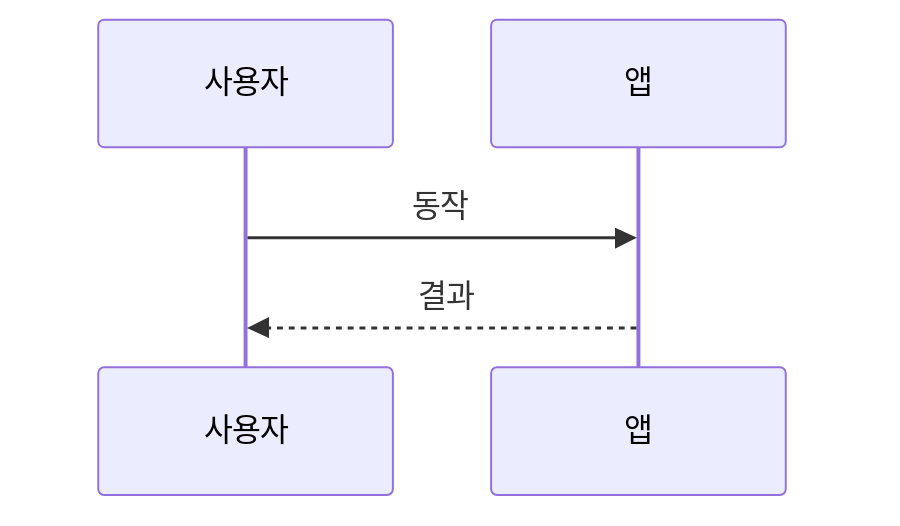

# 설계 문서: {{시스템/기능 이름}}

| 항목 | 내용 |
|---|---|
| 작성자 | |
| 상태 | Draft / Review / Approved / Implemented |
| 관련 PRD | [PRD](../product/PRD.md) |
| 최종 수정 | YYYY-MM-DD |

## 1. 개요

한 문단 요약: 무엇을 어떻게 만드는가.

## 2. 목표와 비목표

- 목표:
- 비목표:

## 3. 시스템 컨텍스트

```mermaid
flowchart LR
  User([사용자]) --> App[{{앱}}]
  App --> Ext[(외부 시스템/저장소)]
```

## 4. 구성 요소

| 구성 요소 | 위치 | 책임 | 의존 |
|---|---|---|---|
| | `apps/…` | | |
| | `packages/…` | | |

## 5. 데이터 모델

- 주요 엔티티와 필드, 저장 위치, 형식

## 6. 주요 흐름



## 7. 인터페이스 / API

- 공개 함수, CLI, HTTP 엔드포인트, 파일 형식 등

## 8. 검토한 대안

| 대안 | 장점 | 단점 | 채택 여부 |
|---|---|---|---|
| | | | |

결정된 사항은 ADR로 남긴다: [ADR-NNNN](../adr/)

## 9. 횡단 관심사

- 오류 처리:
- 로깅·관측:
- 보안:
- 성능:
- 테스트 전략:

## 10. 배포와 마이그레이션

- 빌드·배포 방식, 기존 데이터·설정 호환

## 11. 열린 질문

- [ ] 
